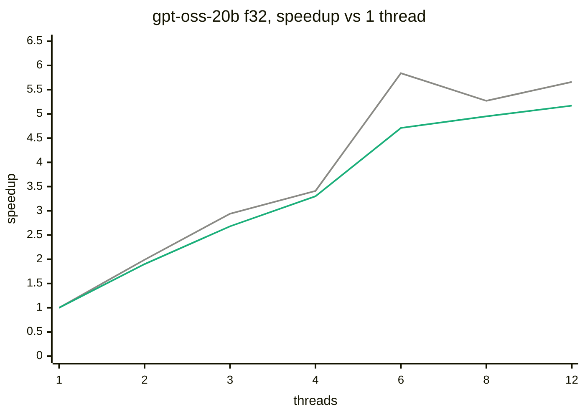

Dequantizer for `.safetensors` in Zig (0.17)

gpt-oss-20b (`openai/gpt-oss-20b`, 12.8 GiB, MXFP4 experts) on Ryzen 5 7600X:

| out_t | 1t | 6t | 12t | GB/s in (6t) | GB/s out (6t) | qw/s (6t) |
|---|---|---|---|---|---|---|
| f32 | 2834 ms | 620 ms | 572 ms | 22.2 | 123.3 | 30.8 G |
| f16 | 3442 ms | 701 ms | 640 ms | 19.6 | 54.6 | 27.3 G |
| bf16 | 4113 ms | 857 ms | 763 ms | 16.1 | 44.6 | 22.3 G |

## Usage

```sh
zig build -Doptimize=ReleaseFast -Dcpu=native
./zig-out/bin/dequant {safetensors_path} {f32|f16|bf16} {threads}
```

Recognized tensor layouts (`src/safetensors.zig`, `HEADERS`):

| scheme | weight | scale | global scale |
|---|---|---|---|
| NVFP4 (1) | U8 | F8_E4M3 | F32 |
| NVFP4 (2) | U8 | F8_E4M3 | F32 (inv) |
| MXFP4 (3) | U8 | U8 (E8M0) | none |

> 1. https://github.com/NVIDIA/Model-Optimizer
> 2. https://github.com/vllm-project/compressed-tensors
> 3. https://huggingface.co/openai/gpt-oss-20b

## Pipeline

```text
main
  parseJson                         single threaded
  spawn N workers

worker
  incremental atomic counter as shared chunk idx
  read -> dequant -> `doNotOptimizeAway()`

dequant block
  unpack     [n/2]u8 -> [n]u8       lo/hi shuffle
  decode     e_m_ -> f32
  loadScale  e_m_ -> f32            lookup translate
  translate  f32                    RTN | std-affine         
  encode     f32 -> out_t           f32 | f16 | bf16
```
The quantization pipeline is modular through `types.Dtype.RECIPE` and `types.Scheme.RECIPE` which holds type recipies. All threads reuse their buffer, kept via `doNotOptimizeAway`.

## Tests

```sh
zig build test
```

- `dequant: nvfp4`, `dequant: mxfp4`: all 16 E2M1 codes x 2 scales, bit-exact for f32 / f16 / bf16 (`-0.0` included)
- `safetensors: parseJson`: scale and global scale merged into the weight layer.

## Benchmarks

Setup: Ryzen 5 7600X (Zen 4, 6C/12T), DDR5, Linux 6.18, boost on, EPP balance_performance, zig 0.17. Files warm in page cache. Min of 3 per shard, summed over shards.

```sh
hf download openai/gpt-oss-20b --include "model-*.safetensors" --local-dir models/gpt-oss-20b
for f in models/gpt-oss-20b/model-*.safetensors; do ./zig-out/bin/dequant "$f" f32 6; done
```

### Per target

```sh
for c in x86_64 x86_64_v2 x86_64_v3 x86_64_v4 native; do
  zig build -Doptimize=ReleaseFast -Dcpu=$c --prefix out/$c
  for f in models/gpt-oss-20b/model-*.safetensors; do taskset -c 2 out/$c/bin/dequant "$f" f32 1; done
done
```

| target | ISA | gpt f32 | gpt f16 | gpt bf16 | kernel nvfp4 ns/w | cyc/block (mca) |
|---|---|---|---|---|---|---|
| x86_64_v1 | SSE2 | 5421 ms | 88353 ms | 7045 ms | 0.289 | 24.1 |
| x86_64_v2 | SSE4.2 | 5449 ms | 88849 ms | 7025 ms | 0.295 | 25.6 |
| x86_64_v3 | AVX2+F16C | 3234 ms | 3579 ms | 3998 ms | 0.152 | 12.0 |
| x86_64_v4 | AVX-512 | 3017 ms | 3278 ms | 3975 ms | 0.143 | 8.4 |
| native | znver4+GFNI | 2834 ms | 3442 ms | 4113 ms | 0.124 | 8.1 |

### Thread scaling



- aqua: compute only, in memory
- blue: current code


**Scaling:**

- Reading from userspace cap at 63 GB/s, reached with 3 threads. Then copies start competing for DRAM bus (not on gpt-oss because quantized weight freq is too high)
- Each layer is one work item. A gpt-oss shard has 20 quantized ones. One 253 MiB tensor takes 85 ms on one thread, against 213 ms of ideal work per thread at 6 threads
- `_copy_to_iter` takes 16% of cycles at 1 thread

Caveat: `out_buf` is reused, so output never reaches DRAM. A real f32 consumer writes 8 bytes per byte of quantized input, so it hits the write-bandwidth limit before compute does.

### Kernel vs llama.cpp

Output f32, 1 thread, kernels only (no file read, parse or orchestration). Median ns/weight.

| size | cache | llama.cpp nvfp4 | HEAD nvfp4 | ratio | llama.cpp mxfp4 | HEAD mxfp4 | ratio |
|---|---|---|---|---|---|---|---|
| 18 KiB | L1 | 0.4604 | 0.1288 | 3.57x | 0.2654 | 0.1277 | 2.08x |
| 584 KiB | L2 | 0.4635 | 0.1294 | 3.58x | 0.2657 | 0.1278 | 2.08x |
| 18 MiB | L3 | 0.4759 | 0.1302 | 3.66x | 0.2674 | 0.1287 | 2.08x |
| 292 MiB | DRAM | 0.4764 | 0.1567 | 3.04x | 0.2685 | 0.1461 | 1.84x |

```sh
./bench/build.sh
./bench/out/bench_llama nvfp4 && ./bench/out/bench_dequant nvfp4
./bench/out/bench_llama mxfp4 && ./bench/out/bench_dequant mxfp4
```

> llama.cpp kernels from `tests/test-quantize-perf.cpp`, master `ded522f8304554317e7ff8f88698dbbbca5425aa` (2026-11-13). Pinned, 3 trials x 20 s, TSC-timed.

### Profiling

```sh
perf stat -e task-clock,cycles:u,cycles:k,instructions:u ./zig-out/bin/dequant "$f" f32 6
perf record -g ./zig-out/bin/dequant "$f" f32 1 && perf report --no-children
objdump -d --no-show-raw-insn --disassemble='bench_dequant.DequantKernel(.nvfp4).Run' bench/out/bench_dequant
llvm-mca -mcpu=znver4 loop.s
echo 0 | sudo tee /sys/devices/system/cpu/cpufreq/boost   # boost off
```

## TODO

- Work item = chunk, not layer
- swap `vcvtps2ph` for `vcvtneps2bf16`
- more layouts
- gpt-oss-120b
- skip read if unquantized to avoid _copy_to_iter
